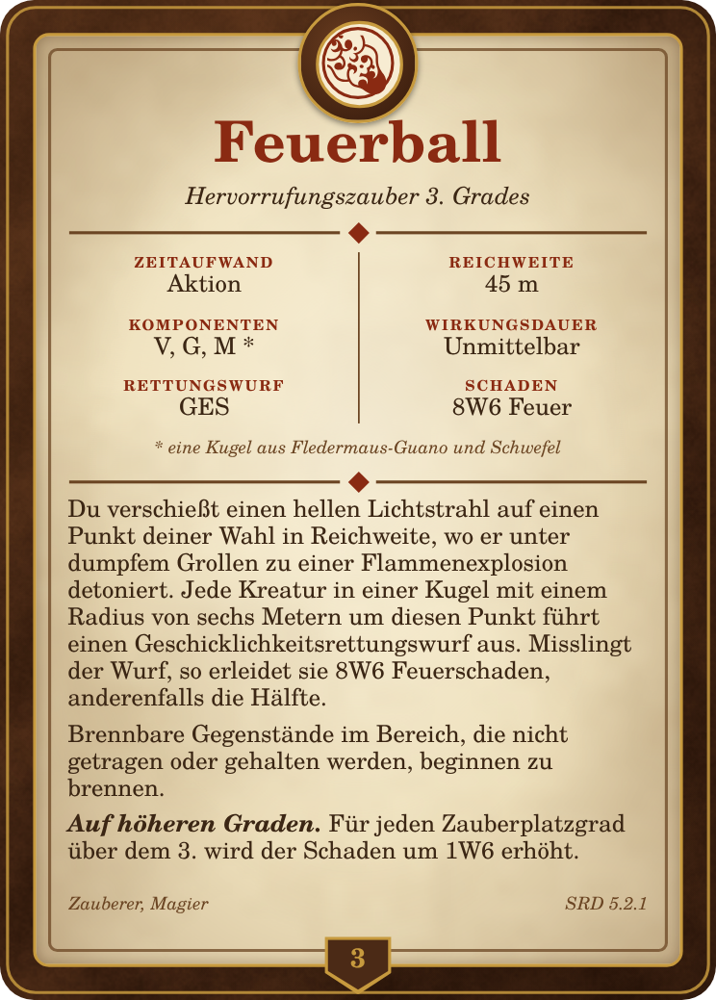

# Card design: Grimoire Codex

Chosen style for all card types (supplement to [SPEC.md](../SPEC.md), section 5).

Example: the spell **Feuerball** (Fireball) with German SRD 5.2.1 text, exported by the app as PNG ("Print & export …" → "PNG images (ZIP)").

| File | Content |
|---|---|
| [grimoire-codex.png](grimoire-codex.png) | Reference image rendered by the app, 744 × 1039 px = 63 × 88 mm at 300 dpi |

The medallion shows the icon of the school of evocation, "fireball" by Lorc from game-icons.net (CC BY 3.0, see [THIRD_PARTY_NOTICES.md](../../THIRD_PARTY_NOTICES.md)). The card text is from the SRD 5.2.1 (CC BY 4.0).

## Structure

From the outside in and from top to bottom:

1. **Leather border**: surrounding band, 2.9 mm wide, dark brown with a leather texture. A fine gold line on the outside.
2. **Parchment**: inner area with a light cloudy texture and vignette, with a fine brown frame line inside.
3. **Medallion**: round, ⌀ 10.5 mm, top centre and protruding beyond the edge. Leather ring with a gold rim, parchment inside with a ring in the accent colour and the type or school icon.
4. **Header**: name centred in the accent colour, below it the subtitle in italics (e.g. "Hervorrufungszauber 3. Grades", "Level 3 Evocation").
5. **Divider**: line with a diamond in the accent colour in the middle.
6. **Property block**: two columns with a vertical centre line, for each field a label in capitals (accent colour) and the value below it, all centred. For spells: casting time, range, components, duration, saving throw/attack, damage. The material text is a footnote (`*`) below.
7. **Rules text**: left-aligned. "Auf höheren Graden." ("Using a Higher-Level Spell Slot.") in bold italics as the lead-in of the last paragraph.
8. **Footer**: on the left the classes or origin, on the right the source, in italics. In the centre, a shield protrudes from the bottom leather band with the level (for items: rarity as an abbreviation).

## Colours

| Role | Value |
|---|---|
| Leather | `#4b2a16` |
| Gold (lines, shield text) | `#c79a3e` |
| Parchment | `#efe1bd`, medallion inside `#f7ecd2` |
| Text | `#3b2614` |
| Lines, footnote, footer | `#6b4523` |
| Accent (spell, evocation) | `#8a2a12` |

The accent colour changes per card type or spell school (SPEC section 5) and affects the name, labels, diamonds and the ring in the medallion. Leather, gold and parchment stay the same for all types.

## Typeface

Serif typeface from the Century Schoolbook family. The original draft was drawn with **C059** (URW). The app and the reference image use the equivalent **TeX Gyre Schola** (GUST Font License, freely distributable; SPEC section 11.1). Sizes at 300 dpi:

| Element | Style | Size |
|---|---|---|
| Name | Bold | 14.4 pt |
| Subtitle | Italic | 6.2 pt |
| Property label | Bold, capitals, letter-spaced | 3.8 pt |
| Property value | Roman | 6.5 pt |
| Rules text | Roman | 6.0 pt (down to 4.8 pt for long texts) |
| Material footnote | Italic | 4.8 pt |
| Footer | Italic | 4.6 pt |
| Level in the shield | Bold | 7.2 pt |

These sizes apply to a rules text that fits on one card. For longer texts, the reduction or continuation card from SPEC section 5 applies.

## Still to check

- **Test print:** the property labels (3.8 pt) are very small. A test print should show whether they remain legible and confirm the minimum size of the rules text (provisionally 4.8 pt, `FONT` in `src/render/paginate.ts`).

## Done

- **Ink and cut:** the leather border extends to the card edge. On the PDF sheet the cards lie next to each other without gaps, and the neighbouring card acts as bleed. On the outside, the grid optionally gets 3 mm bleed (SPEC sections 8 and 11.1).
