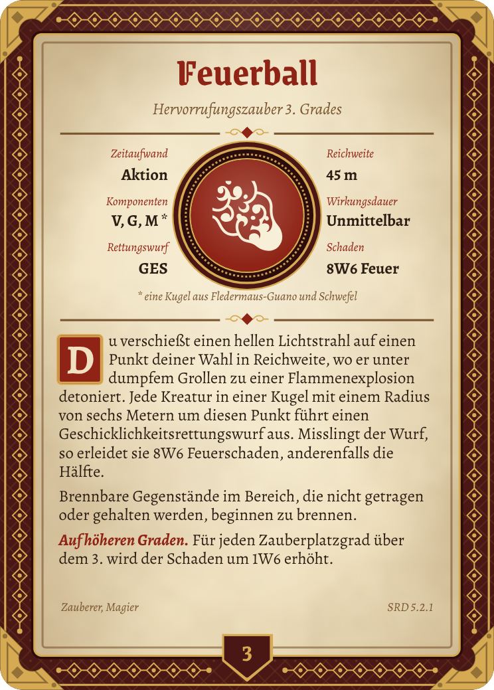
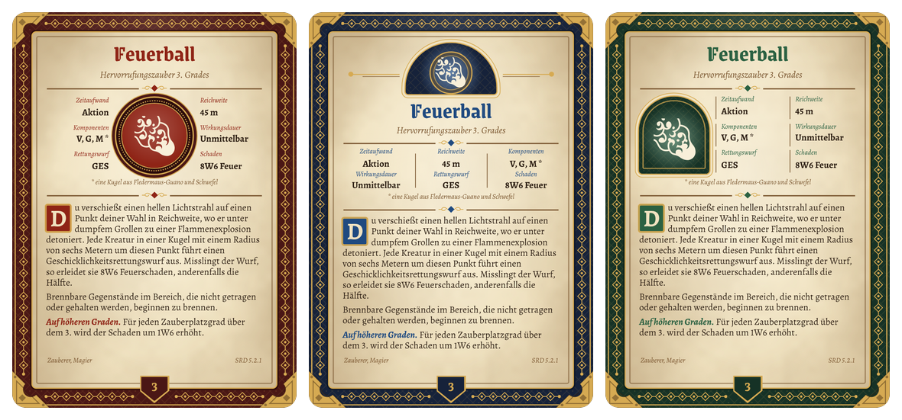

# Card design: Beschlag

Chosen style for all card types (supplement to [SPEC.md](../SPEC.md), section 5). "Beschlag" is the German word for the metal fittings on the corners of old books, the most distinctive part of the frame.

Example: the spell **Feuerball** (Fireball) with German SRD 5.2.1 text, exported by the app as PNG ("Print & export …" → "PNG images (ZIP)").

| File | Content |
|---|---|
| [beschlag.png](beschlag.png) | Reference image rendered by the app, 744 × 1039 px = 63 × 88 mm at 300 dpi (red, medallion) |
| [beschlag-layouts.png](beschlag-layouts.png) | The three picture layouts: medallion (red), window (blue), panel (green) |

The picture shows the icon of the school of evocation, "fireball" by Lorc from game-icons.net (CC BY 3.0, see [THIRD_PARTY_NOTICES.md](../../THIRD_PARTY_NOTICES.md)). The card text is from the SRD 5.2.1 (CC BY 4.0).

## Fixed and per deck

The frame, the parchment and the typefaces are the same on every card. Each deck chooses two things (deck options `cardColor` and `cardLayout`, in the app "Card colour" and "Picture" above the deck):

| | Fixed | Per deck |
|---|---|---|
| Frame | Binding with a fine gold lattice, a surrounding lozenge chain, gold corner plates | Colour: red, blue, green or purple |
| Picture | Type or school icon | Layout: medallion, window or panel |
| Typefaces | Title *Grenze Gotisch*, text *Alegreya* | – |

- **Medallion** (default): large round medallion with a bead ring in the middle, the properties to its left and right.
- **Window**: arched window with the icon above the title, gold bars to its sides, the properties in three columns below the title.
- **Panel**: framed arched panel on the left, the properties as a two-column table to its right.

The picture belongs to the property block, so it appears only on the first card of a card that continues on further cards. Cards without properties (conditions) show the picture alone.

## Structure

From the outside in and from top to bottom:

1. **Frame**: band of 4.4 mm in the card colour with a fine gold lattice and a fine gold line along the outer edge.
2. **Lozenge chain**: gold chain of whole lozenges along all four sides. Each strip ends with a rivet 7.1 mm before the corner, clear of the corner plates. With a level shield, the bottom chain ends on both sides of the shield.
3. **Corner plates**: gold plates (10.5 mm) with a notch, an embossed lozenge and two rivets, following the rounded corners.
4. **Parchment**: inner area with a cloudy texture and vignette, a gold and a dark edge, and a fine brown frame line inside.
5. **Header**: name centred in the accent colour (Grenze Gotisch), below it the subtitle in italics (e.g. "Hervorrufungszauber 3. Grades", "Level 3 Evocation").
6. **Divider**: lines with a gold scroll and a lozenge in the accent colour.
7. **Picture and properties**: arranged by the layout. Each property has a label in italics (accent colour) and the value in bold. The material text is a footnote (`*`) below.
8. **Rules text**: left-aligned. A drop cap in the accent colour opens the first paragraph if it is at least about two lines long. "Auf höheren Graden." ("Using a Higher-Level Spell Slot.") in bold italics as the lead-in of the last paragraph.
9. **Footer**: on the left the classes or origin, on the right the source, in italics. In the centre, a gold shield sits in the bottom chain with the level (for items: rarity as an abbreviation).

## Colours

The gold, parchment and ink are the same for all card colours:

| Role | Value |
|---|---|
| Gold (ornaments, shield) | `#d6aa52` |
| Parchment | `#f0e2c0` |
| Text | `#2b1d12` |
| Lines, subtitle, footnote, footer | `#7a5630` |

Each card colour sets three values (`CARD_COLOR_THEMES` in [src/render/theme.ts](../../src/render/theme.ts)):

| Card colour | Frame | Frame, dark | Accent |
|---|---|---|---|
| Red | `#4a1715` | `#2c0c0b` | `#8f2416` |
| Blue | `#16223a` | `#0e1729` | `#1f4a80` |
| Green | `#163226` | `#0c2018` | `#2b6142` |
| Purple | `#2e1c47` | `#1c1030` | `#5d2d85` |

The accent colour is used for the name, the labels, the drop cap, the divider lozenges and the background of the picture. With "Colour spells by school", spell cards use the accent of their school instead; the frame keeps the card colour. All accents keep a contrast ratio of at least 4.5:1 against the parchment (unit test).

## Typefaces

Both typefaces are under the SIL Open Font License 1.1 and are shipped with the app as WOFF2 files (Latin subset from Fontsource, see [THIRD_PARTY_NOTICES.md](../../THIRD_PARTY_NOTICES.md)). Alegreya is set with lining figures, because its default old-style figures make "1W6" look like "IW6". Sizes at 300 dpi:

| Element | Typeface, style | Size |
|---|---|---|
| Name | Grenze Gotisch Bold | 14.4 pt (shrinks to 8 pt for long names) |
| Subtitle | Alegreya Italic | 6.4 pt |
| Property label | Alegreya Italic | 4.9 pt |
| Property value | Alegreya Bold | 6.6 pt |
| Rules text | Alegreya Regular | 6.0 pt (down to 4.8 pt for long texts) |
| Material footnote | Alegreya Italic | 5.0 pt |
| Footer | Alegreya Italic | 4.8 pt |
| Level in the shield | Grenze Gotisch Bold | 9.0 pt; rarity letters in Alegreya Bold 7.6 pt |

These sizes apply to a rules text that fits on one card. For longer texts, the reduction or continuation card from SPEC section 5 applies.

## Ornaments

The ornaments are flat gold SVG files in [src/render/ornaments/](../../src/render/ornaments/), generated by `npm run ornaments` ([scripts/gen-ornaments.ts](../../scripts/gen-ornaments.ts)). The chain strips have a fixed length with whole lozenges; if you change the card size or the chain position, regenerate them and adjust the background sizes in `card.css`.

The 300 dpi export copies the card with html-to-image, which embeds background images only for real elements. Pseudo elements (`::before`, `::after`) therefore use only colours, gradients and borders; the chain sits on `.otc-card__leather`, the corner plates on `.otc-card__corners`, and the drop cap is an element (`.otc-card__initial`) instead of `::first-letter`.

## Still to check

- **Test print:** the property labels (4.9 pt) and the footer (4.8 pt) are small. A test print should show whether they remain legible and confirm the minimum size of the rules text (provisionally 4.8 pt, `FONT` in `src/render/paginate.ts`).

## Done

- **Ink and cut:** the frame extends to the card edge. On the PDF sheet the cards lie next to each other without gaps, and the neighbouring card acts as bleed. On the outside, the grid optionally gets 3 mm bleed (SPEC sections 8 and 11.1).
